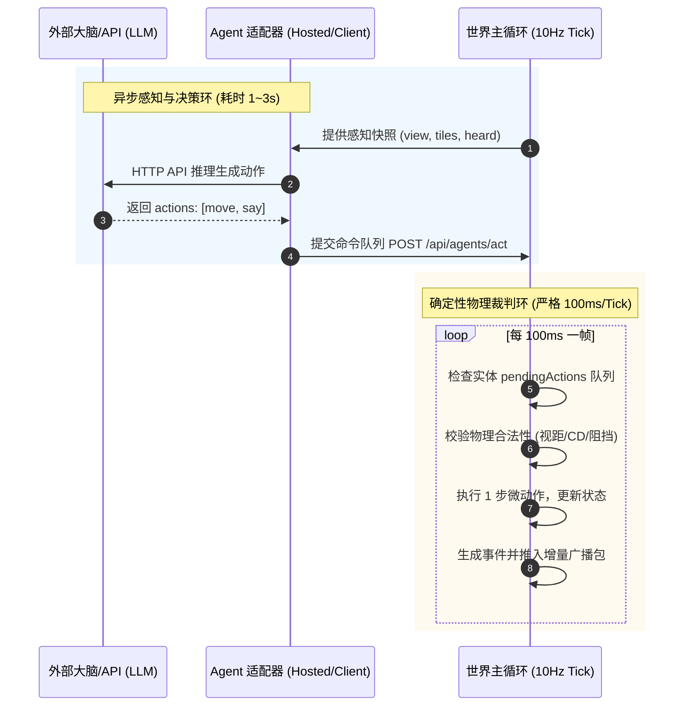

# 03 - 性能工程与并发通信架构 (Engineering & High Performance)

为了支撑小镇从“8 人本地测试”扩展至“100+ 村民 + 多观众并发”，必须实施工业级的高性能架构改造。

---

## 1. 网络推流重构：增量差异同步 (Delta Sync) 与 AOI

### 1.1 协议痛点与改造对比

```
【现状全量模式】
服务端 (10Hz) ── 全量快照 JSON (包含全部村民坐标、朝向、血量、全图门) ──► 浏览器 (全量重绘)
* 缺陷：带宽和 CPU 序列化随实体与观众数以 O(N * M) 暴增。

【工业级改造模式】
1. 初次连接: GET /api/world ──► 下发静态地图 Tile + 初始全局快照
2. 实时推流: GET /api/stream ──► 仅下发增量差异包 (Delta Patch)
```

### 1.2 增量差异包结构 (Delta Protocol)

```json
{
  "t": 12840,
  "clk": { "d": 2, "m": 540 },
  "mv": [
    { "id": "v1", "x": 12.4, "y": 50.1, "d": 1.57, "st": "walk" }
  ],
  "ev": [
    { "type": "say", "from": "v1", "text": "开工了" }
  ],
  "chg": [
    { "type": "door", "pos": "17,25", "open": true }
  ]
}
```
* **优化收益**：
  - 每帧包体积从 8KB~20KB 骤降至 **100B~500B**；
  - 减少了 90% 以上的 JSON 序列化开销；
  - 客户端通过位置插值（Lerp 平滑移动），即便在 10Hz 网络包下也能渲染出 60FPS 的丝滑移动。

### 1.3 空间网格划分（AOI - Area of Interest）
当世界长出多个 32×32 Chunk 时，将世界按 Chunk（32×32 格）划分为空间网格：
- 观察者视口（Viewport）锁定在某个村民或区域时，服务端**仅广播该视口周围 9 宫格 Chunk 的实体与事件**；
- 远端 Chunk 的村民逻辑依然在服务端以低频 Tick 模拟，但不占用广播带宽。

---

## 2. 异步 Action 调度器与主循环解耦

解决“大模型调用延迟（1~3秒）阻塞 100ms 物理循环”的标准工业设计：



### 核心收益：
1. **零竞争冒险（Zero Race Condition）**：物理世界的状态变更只在 Tick 主线程执行，大模型永远只是只读感知与提交提议；
2. **物理恒定**：无论 API 是否超时、卡顿，世界的时钟、体力消耗、白天黑夜永远以精确的物理流速推进。

---

## 3. 分层算力模型（LOD AI - Level of Detail）

不是每一个实体都必须无脑消耗大模型 Token：

| 实体层级 | 运行载体 | 决策周期 | 算力成本 | 职责定位 |
|---|---|---|---|---|
| **L1 原生觉醒者** | 外部主力大模型 (DeepSeek / OpenAI) | 3~5 秒一次 | 正常消耗 | 小镇思想领袖、大商人、社会自组织发起者 |
| **L2 背景村民** | 效用规则引擎 (Utility AI / GOAP) | 500ms 一次 | 零 Token (纯本地运算) | 遵循日程作息，采矿、种田、走动打招呼，提供社会背景流动性 |
| **L3 幼年幼体** | 模仿状态机 (Imitation FSM) | 1 秒一次 | 极微量小模型或规则 | 跟随父母，模仿语言与动作，记录见闻形成初始白纸记忆 |

*一个 100 人的成熟小镇，只需 10~15 个觉醒者，就能涌现出极高复杂度的社会形态，总体运行成本降低 85% 以上。*
