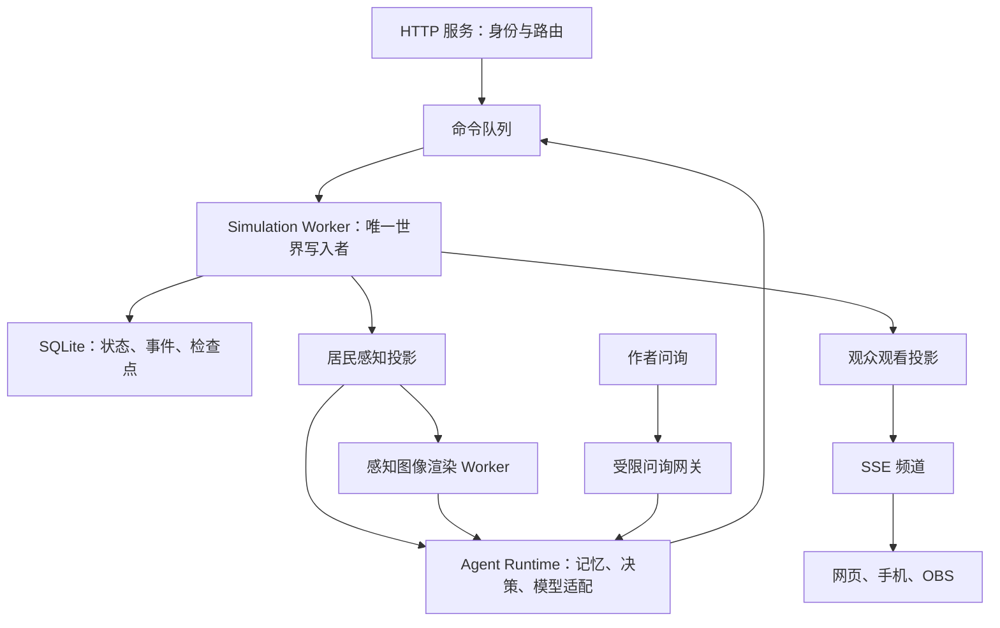

# 大肥鱼世界：感知、身份、交流与观看系统技术路线指导

## 一、目标、边界与技术选型

本路线作为下一阶段的实现规格。交付目标是：

**10–30 名 AI 居民，无论使用云模型、本地文字模型还是多模态模型，都通过统一规则感知世界、识别人、交流和积累经历；作者与公众通过权限明确的窗口观看，观看数据不会混入居民认知。**

本阶段完成感知、身份、对话、模型接入、观看权限、网页和移动端、基础直播入口。自然哲学探索、高精度物理、合资 AI、模型权重训练及各直播平台账号集成不属于本阶段验收。

### 1. 固定技术路线

| 部分 | 采用方案 |
|---|---|
| 世界内核 | 保留 JavaScript ES Modules，固定 10 Hz 模拟 |
| 世界写入 | 一个 Simulation Worker 独占世界状态与持久化写入 |
| HTTP 服务 | 主线程负责鉴权、请求校验、路由和流连接，不直接修改实体 |
| 持久化 | SQLite，使用已验证运行环境中的 `node:sqlite`；WAL、外键、完整事务 |
| 参数校验 | JSON Schema，使用 Ajv；接口、提示词说明与测试共用动作定义 |
| 模型调用 | 统一 Agent Runtime，分别适配云推理、本地推理连接器和外部 Agent |
| NPC 图像 | 独立渲染 Worker，用 Canvas 从过滤后的感知数据生成 PNG |
| 人类界面 | 保留浏览器 Canvas，改为消费专用观看协议 |
| 实时观看 | HTTPS + SSE；命令与设置使用 HTTP |
| 自动化测试 | `node:test` 测内核与协议，浏览器自动化测试界面和跨端行为 |

继续使用现有 `.mjs`，本阶段不整体迁移 TypeScript。通过 JSDoc、JSON Schema 和测试约束数据结构。

Node 的 SQLite API 是同步执行的，因此放在模拟 Worker 内，避免阻塞 HTTP 与观看连接；不能把“使用 Worker”当成数据库不会拖慢模拟的保证，仍须测提交延迟。[Node.js SQLite 文档](https://nodejs.org/api/sqlite.html)

### 2. 五条不可破坏的约束

1. **模型只能读感知数据，不能读 World 对象或全局快照。**
2. **所有外部输出先过滤，再编码成 JSON、图像、字幕或音频。**
3. **只有模拟 Worker 可以改变世界；异步模型回复只能提交命令。**
4. **已经提交的世界状态、感知事件和行动结果必须可以一致恢复。**
5. **观看权限、控制权限、作者权限、管理员权限分别校验。**

验收时，违反任何一条都属于阻断问题，不能用“界面正常”或“模型一般不会这样做”豁免。

---

## 二、目标架构与数据契约

### 1. 模块职责



| 模块 | 负责内容 | 禁止事项 |
|---|---|---|
| Simulation | tick、实体、移动、动作、对话进度、世界事件 | 调用模型、等待浏览器、依赖界面隐藏数据 |
| Perception | 视觉、听觉、识人进度、个人地图、感知事件 | 发送全局实体后要求调用者自行过滤 |
| Identity | UID、接触标识、个人熟悉度、称呼记录 | 用后台 ID 为陌生人自动匹配历史身份 |
| Agent Runtime | 消费感知、保存记忆、组织上下文、处理模型回复 | 直接修改位置、库存和对话状态 |
| Observer | 私有镜头、公开镜头、字幕、频道历史 | 共用居民的事件消费游标 |
| Persistence | 事务、检查点、迁移、回放 | 存档错误后静默创建新世界 |
| Inquiry Gateway | 作者问询题型、后期文本审查 | 把人类原文直接拼进居民提示词 |

现有三个主要改造入口是：

- [世界与事件实现](../../sim/src/world.mjs)
- [服务器、存档与接口](../../sim/server.mjs)
- [托管模型运行器](../../sim/agents/hosted.mjs)

按照职责逐步抽取，保留现有可用逻辑，不一次性重写全部工程。

### 2. 三种数据对象必须分开

**WorldState：世界事实**

包含真实实体 ID、完整 UID、全部位置、地图、物品和对话待发内容。仅模拟、持久化和管理员诊断模块使用。

**PerceptionSnapshot：居民此刻感知**

包含自身状态、可见对象、已经听到的片段和行动结果。不得包含其他居民的完整对象。

**ViewFrame：某位观众获准观看的内容**

根据作者身份、镜头模式和频道公开状态生成。全景镜头的数据也不能回流到 PerceptionSnapshot。

禁止继续用一个 `pub()` 同时生成以上三类输出。

### 3. 居民观测结构

统一观测至少包含：

```text
PerceptionSnapshot
  schemaVersion
  worldId / branchId
  snapshotId / tick
  self
  vision
    tiles
    objects
    persons
  hearing
  actionResults
  eventCursor
```

具体要求：

- `self`：自己的坐标、朝向、身体状态、背包、当前动作。
- `tiles`：17×17 局部窗口，应用 8 格视距、120° 视锥和遮挡；未知格明确标记。
- `objects`：已看见物件的类型、位置、可见状态和交互类型。
- `persons`：当前接触标识、外观、认出的 UID 片段、已经获得的称呼。
- `hearing`：已送达的文字片段、方向、距离区间、来源是否已识别。
- `actionResults`：自己动作的接受、完成、失败、中断记录。
- `eventCursor`：个人事件序号；读取不删除事件。

视觉判定统一使用同一算法。可以看见阻挡物的表面，但不能看见其后方；贴脸 2 格只放宽朝向要求，不取消墙体遮挡。

个人记忆另外检索，不把完整记忆全部塞进每次快照。地图记忆保存：

```text
位置 + 当时看到的内容 + 观察时间 + 来源类型
```

来源区分亲见、转述、推断。离开后，地图不随真实世界自动更新。

### 4. 事件与命令契约

事件分三层：

- 内部世界事件：完整事实，仅服务端使用。
- 居民感知事件：按接收者过滤并持久化。
- 观看事件：按频道权限过滤，可用于字幕和回放。

居民与频道分别使用自己的递增序号，避免通过全局事件序号推测隐藏活动。

命令统一携带：

```text
commandId
controllerEpoch
sequence
basedOnSnapshotId
expiresAtTick
action
```

规则：

- 角色身份从凭据取得，不相信请求体中声称的身份。
- `commandId` 去重，重复提交返回原结果。
- 模式切换增加 `controllerEpoch`，旧模型回复失效。
- 命令在 tick 内重新检查目标、距离、状态和时效。
- HTTP 返回“已入队”不等于动作成功。
- 耗时动作通过后续事件报告完成；不得将多个命令数组解释成自动等待前一步完成的计划。

### 5. 事务与恢复

每个 tick 的顺序固定为：

1. 接收并排序待处理命令。
2. 验证并推进动作与身体状态。
3. 推进发言时间线。
4. 计算感知、熟悉度和接收者事件。
5. 在同一事务中保存变更与结果。
6. 提交成功后，向 HTTP、模型运行器和观众发布结果。

事务失败时暂停推进并报告故障，不发布尚未提交的成功结果。

持久化必须包括：

- UID、熟悉度、称呼和个人地图。
- 进行中动作、冷却、控制器世代。
- 发言全文、已说到的位置、开始 tick、中断状态。
- 每名居民已接收的片段与已处理事件游标。
- 作者绑定、频道设置、公开状态版本。
- 待处理模型任务、记忆和已接受的模型决策。

每 60 秒生成检查点，保存随机数状态与版本信息。回放使用已记录命令和模型决策，不重新调用模型。

---

## 三、各子系统的实施规格

### 1. UID 与身份识别

内部采用：

```text
Recognition(observerEntityId, targetEntityId)
  effectiveVisibleTicks
  revealOrder
  revealedCount
```

- 每个方向独立累计。
- 距离不超过 5 格且实际可见，每 tick 累计 0.1 秒。
- 初见揭示 1 位；累计每 20 秒再揭示 1 位。
- UID 为 7 位，唯一性由数据库约束。
- 揭示顺序创建后保存，不能每次查询重新随机。
- 隐藏状态中的昏迷、倒地等不产生有效观察时间。

内部可以使用实体 ID 维护数据，但对居民输出时不得附带这条后台关联。

**当前接触标识**使用随机的不透明引用，只在该观察者当前连续可见的接触期间有效。遮挡或离开视野即失效；重新看见时生成新引用。

对旧引用提交动作，返回 `target_not_perceived`，不能自动解析成远处真实角色。

居民自己的记忆使用个人记录 ID；系统根据已知 UID 片段、称呼和外观提供候选，不借助后台实体 ID 自动确认陌生人身份。片段碰撞时保留多个候选。

名字采用“称呼主张”：

```text
称呼文本 + 谁这样说 + 何时听到 + 对应的个人身份候选
```

陌生人默认显示外观描述。听到对方报完整 UID 仅记录为口头主张，不直接解锁识别进度。

### 2. 文字与图像感知

文字观测是所有模型的共同基线。服务端提供确定性的短摘要和结构化数据，摘要不能自行补充动机、职业和关系。

图像接口采用：

- 默认 544×544 PNG，对应 17×17 格、每格 32 像素。
- 仅绘制 PerceptionSnapshot，不访问 WorldState。
- 未知区域统一遮罩。
- 使用当前接触标识标注人物，方便模型将图像目标对应到动作参数。
- 角色外观、衣着和标记在文字中有对应描述。
- 不在画面中绘制他人私聊或未来字幕。
- 图像与文字的 `snapshotId` 必须一致。

将绘图逻辑抽为纯渲染模块，浏览器与服务端共用场景描述；服务端通过 Canvas 生成 PNG。渲染失败时回退到同一快照的文字数据，记录降级，不回退到全景截图。

图片缓存按居民与快照隔离，默认保存 60 秒；每次读取都鉴权。频道公开变化不能通过旧图片缓存被绕过。

### 3. 听觉与对话时间线

第一版采用明确的离散听觉规则：

| 模式 | 内容可达范围 |
|---|---|
| 普通说话 | 6 格 |
| 低语 | 2 格 |
| 喊话 | 12 格 |

墙和关门阻隔声音。距离内、无遮挡、非私聊的内容可以听懂，不要求看见说话者；无法认出来源时只提供方向和未知来源标识。

私聊需要明确收件对象，只向该对象提供内容，并且仍要满足距离和隔音条件。旁人最多获得“发生低语”的事件。

**紧急程度与音量分开。** 紧急低语不会自动获得喊话距离。

发言状态机：

```text
Queued → Speaking → Completed
                  ↘ Interrupted
```

参数固定为首轮调优基线：

- 普通中文 5 字/秒，英文 3 词/秒。
- 使用 `Intl.Segmenter` 切分词和可显示字符；混合文本累计相应时长。
- 逗号停顿 0.2 秒，句末停顿 0.4 秒。
- 单条不超过 280 个可显示字符。
- 紧急短句不超过 30 字，速率最高为普通的 3 倍。
- 紧急通道每个居民 10 秒一次。
- 同时只能有一条正在说的内容；允许一条普通待发内容，更多请求返回忙碌。
- 紧急发言中断自己的普通发言，未说部分作废并产生中断记录。

每 tick 推进时间，每秒形成一次已说出的片段；结束和中断立即产生事件。每个片段发布时重新计算接收者。

听者后来进入范围，不补发前文；离开后不发送后文。模型只收到已经传达的片段。

模型侧的普通对话触发合并到一句结束或每 2 秒一次；紧急事件提高调度优先级，但不能无限制造模型调用。

观众字幕按同一时间线显示，可以回看和慢读。直播流不得预先发送整句全文，禁止“完整文本提前下发、前端再做打字动画”。

### 4. 统一模型接入

控制器分为三个标识：

- `managed-cloud`：统一运行器调用云模型。
- `managed-local`：统一运行器组织上下文，本地连接器执行推理。
- `external-agent`：外部程序自行管理决策，使用世界协议。

所有模式使用相同的感知与命令校验。

本地连接器采用主动长轮询领取任务，避免要求用户开放入站端口：

1. 作者建立连接器绑定。
2. 连接器领取推理任务。
3. 连接器调用本机模型地址。
4. 返回结构化结果。
5. 服务器检查任务租约、控制器世代和截止时间。
6. 有效结果才转成世界命令。

本地模型密钥和地址可以保留在用户电脑；连接器凭据只允许读取自己的任务和提交结果，不具备作者管理权限。

初始调度参数：

- 每名居民最多一个进行中的推理任务。
- 云推理全局并发上限 4。
- 本地任务租约默认 60 秒。
- 失败退避 5、15、30、60 秒，最高 60 秒。
- 开始任务前检查预算；记录实际调用量、延迟和返回的 token 用量。
- 降级为文字模式必须记录，不能悄悄换模型。
- 无效结构化输出视为决策失败，不执行“猜出来”的动作。

统一运行器先将感知写入记忆，再推进事件处理游标。模型失败不能导致事件丢失。

断线不会删除居民身份或作者绑定。已经接受的有限动作继续执行，结束后等待；是否采用脚本接管由显式配置决定，接管必须留下记录。

### 5. 作者权限、公开频道与问询

作者账户通过邀请建立，使用标准密码哈希和服务端会话。浏览器使用 HttpOnly 会话 Cookie，写操作检查 CSRF；Agent 使用独立 Bearer 凭据。

权限范围至少包括：

```text
resident:observe
resident:act
owner:watch
owner:configure-channel
owner:inquire
public:watch-channel
admin:diagnose
```

普通观看凭据不能调用行动接口；控制凭据不能修改作者账户。

一个作者窗口可切换两种模式：

- **感知镜头**：展示自己的 NPC 获准知道的内容。
- **附近全景**：默认以 NPC 为中心的 25×25 格区域，展示附近场景，但不穿透建筑、不显示他人库存或私有记忆。

全景使用独立 Watch DTO，不进入模型上下文。名字和 UID 不因切换全景而解锁；额外看见的陌生人使用外观描述。

频道设置包括：

```text
公开或私有
公开使用的镜头模式
设置版本 channelRevision
```

公开频道始终过滤私聊、作者问询和作者专属信息。公开不是权限等级更高的镜头。

关闭公开时：

- 增加频道版本。
- 终止现有公开 SSE 连接。
- 禁止新的公开查询。
- 使受控缓存与服务端回放入口失效。
- 已经下载或录制的内容不承诺撤回。

作者问询先实现固定题型：

- 当前感受。
- 最近经历。
- 对自己已经讲述的某件事继续解释。

第三种题型只能引用已有回答的事件 ID，不能携带任意人物、地点或自由文本。每个居民最多一条待处理问询，默认每分钟一次。

问询只对成年且允许此通道的居民开放；年龄不明时默认关闭。不能为支持作者聊天绕过原有未成年隔离设定。

大后期自由文本审查采用两层：

1. AI 将原文映射成允许的题型和已授权事件引用。
2. 确定性校验器验证题型、引用归属和速率。

只有规范化后的问询进入居民上下文，原文不会直接转发。无法映射则拒绝。记录审查版本和结果；不声称 AI 审查能够保证绝对零干预。

### 6. 网页、移动端、直播与回放

同一前端提供三种布局：

- 电脑：场景、人物信息和对话时间线。
- 手机：竖屏场景，下方可展开字幕与记录。
- 直播：隐藏操作控件，提供横屏和竖屏安全区。

SSE 使用：

- 初始快照。
- 带版本的增量状态。
- 对话与事件新增片段。
- 心跳。
- 需要重新同步的通知。
- 权限撤销通知。

默认状态推送 5 Hz，浏览器插值渲染。每 15 秒心跳；状态带 `baseVersion`，缺增量时重新获取快照。

单连接缓冲超过 1 MiB 时断开慢连接并要求重同步，不能无限积压。事件通过独立序号恢复，不能和可替代的画面状态一起随意丢弃。

OBS 只需要加载公开直播页面，第一版无需接入各个平台账号；平台推流由 OBS 完成。[OBS Browser Source](https://obsproject.com/kb/browser-source)

公开历史只包含**当时公开期间**产生的过滤后观看数据。后来开启公开，不自动公开此前的私人历史。

壁纸后置为网页宿主适配，默认静音、15 FPS、断线显示最后画面与状态；窗口不可见时降低渲染频率。剪辑先提供公开片段回放与 WebVTT 字幕导出，成片可由 OBS 或剪辑软件制作，不先建设云视频转码平台。

---

## 四、协议、迁移与开发顺序

### 1. 对外接口统一进入 v2

| 接口组 | 路径示意 | 契约 |
|---|---|---|
| 观测 | `GET /api/v2/resident/observation` | 只读，不清空事件 |
| 感知事件 | `GET /api/v2/resident/events?after=` | 按个人游标增量读取 |
| 行动 | `POST /api/v2/resident/commands` | 去重、世代校验、返回入队结果 |
| 感知图像 | `GET /api/v2/resident/snapshots/:id/image` | 验证属于当前居民 |
| 能力 | `GET /api/v2/capabilities` | 从统一动作定义生成 |
| 本地推理 | `/api/v2/connector/tasks` | 领取任务与提交租约结果 |
| 作者窗口 | `/api/v2/owner/residents/:id/view` | 验证作者绑定与镜头模式 |
| 作者问询 | `/api/v2/owner/residents/:id/inquiries` | 固定题型、速率与年龄检查 |
| 频道设置 | `/api/v2/owner/residents/:id/channel` | 作者专属 |
| 公共目录 | `GET /api/v2/channels` | 只列公开频道 |
| 频道数据 | `/api/v2/channels/:id/snapshot`、`stream`、`history` | 权限一致、统一过滤 |
| 管理诊断 | `/api/v2/admin/*` | 与普通观看彻底分离 |

错误结果统一为机器可读代码，覆盖 `unauthorized`、`target_not_perceived`、`stale_controller`、`expired_command`、`busy`、`rate_limited`、`snapshot_expired`。

旧的无鉴权全图与日志接口停止公开。旧客户端通过适配器迁移到 v2，不能为兼容而继续保留泄露路径。

作者观看链接不得继续携带可控制 NPC 的 token。公开频道使用频道 ID；需要私有设备配对时，使用一次性配对码换取仅观看会话。

### 2. 旧存档迁移

迁移必须离线进行，顺序固定：

1. 停止旧世界服务。
2. 对源码、地图、世界存档、Agent 绑定和必要密钥做一致备份。
3. 将旧数据导入新的实验分支，保留原文件。
4. 验证所有引用、UID 唯一性、地图边界与实体位置。
5. 生成迁移报告。
6. 通过验证后才启动新分支。

处理已知缺失：

- 地图以运行存档为依据，Tiled 仅作为创世模板。
- 已存在的 UID 保留；重复或缺失时记录修复结果。
- 旧 `pairs` 为双向共享记录，不能准确还原单向认识；保留为历史资料，新分支从新的单向识别基线开始。
- 旧 explored 只有坐标，不能证明当前内容；保留“到过这里”，地形内容标记未知，重新观察后更新。
- 未保存的天赋、冷却、衣着等不能声称恢复；按迁移规则初始化一次并记录。
- 已丢失的地图或历史不猜测重建。
- 旧 token 不自动获得作者管理权限；作者绑定由管理员明确分配。
- 年龄缺失的居民不得默认开通人类问询。

迁移属于明确的新实验基线，不能把无法恢复的数据伪装为连续历史。

### 3. 按依赖推进，不按界面展示推进

| 阶段 | 工作包 | 完成门槛 |
|---|---|---|
| M0 基线 | 固定运行版本、依赖锁、测试入口、数据目录配置、隔离测试存档 | 干净目录可启动，不写真实世界数据 |
| M1 状态与协议 | 单写入者、命令队列、事务、事件序列、迁移工具 | 崩溃恢复、去重、控制权切换通过 |
| M2 感知与身份 | 分离 DTO、统一视觉/听觉、个人地图、单向 UID、接触标识 | 全部泄露测试通过 |
| M3 对话 | 发言状态机、分段送达、紧急通道、字幕事件 | 关门、离场、打断、重启均正确 |
| M4 模型运行器 | 云、本地连接器、外部 Agent、记忆与回执、可选图像 | 同一协议可驱动三种接入模式 |
| M5 观看权限 | 作者账户、双镜头、频道公开、撤销、固定问询 | 角色与频道权限矩阵通过 |
| M6 多端交付 | 电脑、手机、OBS 页面、回看、字幕导出 | 跨端与断线测试通过 |
| M7 后期能力 | 壁纸适配、自由文本审查、创作工具增强 | 分别验收，不影响 M0–M6 完整交付 |

M1–M3 未通过前，不以增加模型数量、打磨直播画面或扩充物理机制替代修复。

每个工作包必须同时交付：代码、协议说明、自动化测试、演示场景、已知限制。不能只有“接好了”的状态描述。

---

## 五、测试、验收与交付要求

### 1. 必须建立的自动化测试

| 类别 | 关键用例 |
|---|---|
| 信息隔离 | 墙后人物、关闭容器、私聊、完整 UID、未来文本不能通过任何居民输出泄露 |
| 间接泄露 | 事件嵌套对象、图像标签、错误响应、历史接口、缓存和频道元数据同样检查 |
| 身份 | 单向观察、重复相遇、称呼变化、片段碰撞、报出完整 UID、重启保持进度 |
| 对话 | 中途加入、离开、关门、多人重叠、紧急打断、超长文本、混合语言 |
| 持久化 | 发言中断电模拟、命令提交前后终止、记忆游标恢复、地图恢复 |
| 模型接入 | 文字模型、图像模型、慢模型、非法 JSON、重复回复、过期租约、切换模式 |
| 权限 | 作者不能看别人的私有频道；观看凭据不能行动；关闭公开后旧连接与历史查询失效 |
| 问询 | 隐藏地点、未知人物、行动暗示、编码文本、跨轮诱导不能进入允许题型之外 |
| 多端 | 电脑、手机、OBS 的事件顺序一致，掉线恢复没有重复字幕和身份串线 |

特别增加一类**不可区分测试**：

> 构造两个世界，它们只在观察者看不到的地方不同。观察者得到的文字、图像和错误结果应保持相同，除非确实产生了可听见或可观察的后果。

这比只测试“没有 talent 字段”更能证明感知隔离。

### 2. 回放与长跑验收

正式验收顺序：

1. 内核与协议测试。
2. 隔离 HTTP 集成测试。
3. 纯文字和可选图像控制器的完整交互。
4. 30 个模拟控制器、10 个观看连接的 72 小时长跑。
5. 在明确模型预算下进行真实云模型和本地模型接入验证。

72 小时长跑不要求全部使用付费模型；稳定性测试使用可控模型桩和故障注入，真实模型验证另计。

首轮性能目标：

- 10 Hz 下模拟与事务提交的 P99 小于 50 ms。
- 不出现持续超过 1 秒的模拟积压。
- 模型故障不阻塞世界推进。
- 关闭公开后，1 秒内终止服务端公开数据发送。
- 断线恢复不丢失保留期内的感知事件。
- 队列、缓存、连接缓冲均有上限，长跑不出现无界增长。

这些是验收目标，不是当前代码已经达到的结论。测试必须记录硬件、数据量、依赖版本与负载配置。

若性能未达标，先定位事务、感知扫描、序列化或图像渲染的耗时，不直接引入分片。

### 3. 最终交付物

开发完成时，必须具备：

- 本技术路线对应的实现说明及状态表。
- v2 接口与 JSON Schema。
- 权限矩阵和观测字段白名单。
- UID、发言、控制器任务三个状态机说明。
- 离线迁移工具、迁移报告与恢复操作说明。
- 纯文字、本地图像、外部 Agent 三种接入示例。
- 作者私有窗口、公共目录、移动端和 OBS 演示入口。
- 自动化测试结果、72 小时长跑报告和真实模型验证记录。
- 已知限制清单，明确哪些内容尚不能保证。

**完成标准：在同一世界里，纯文字与多模态 NPC 都能获得受限且一致的经历；认人、说话、记忆和重启具有连续性；作者和观众能通过多种窗口观看，但无法借观看接口绕过居民的信息边界。**

