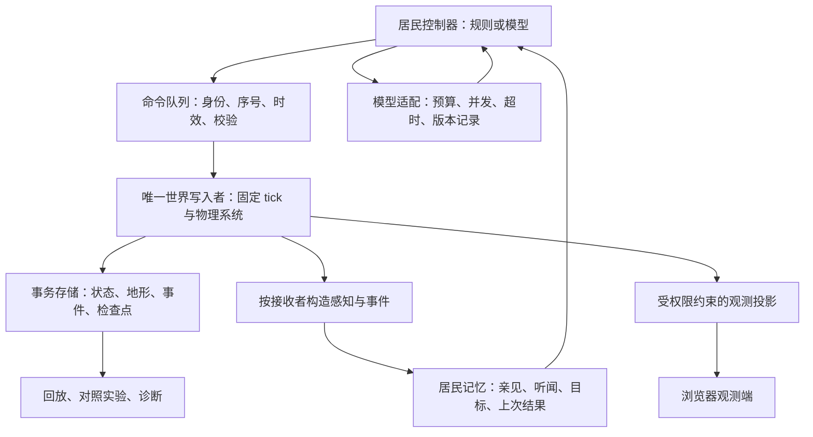

# 大肥鱼世界：技术路线与实现架构审查

审查日期：2026-11-03。评估目标由项目方确认：**10–30 名居民，小规模长期实验，优先保证演化可信度**。

**结论：保留 Node.js 无头模拟内核与浏览器观测端；把接下来一个阶段用于建立可信的实验底座。当前实现能展示居民活动，但尚不足以支持“经济、信用和性格由经历自然演化”的结论。** 感知泄露、记忆缺失、资源闭环缺失和存档不完整，会直接污染实验结果。此时增加代际、论坛和更多内容，只会让污染更难定位。

本次阅读了根 README、六份主设计文档、sim 接口文档、World/Map/经济/技能/地形代码、服务器、两种内置控制器、bridge、外部客户端示例及测试；针对观测端、Tiled 工具链和 C# 支线做了静态检查。执行了现有自检、25 项定向核验、10/30 人纯内核微基准，以及现有服务的只读查询。没有修改游戏源码和真实存档，没有调用真实模型；重启和写入验证全部在本报告目录内的隔离副本进行。运行中的真实存档会继续变化，证据文件对关键源码记录了 SHA-256。

**1. 技术路线：主方向可以继续，开发顺序必须调整。**

现有工程最有价值的基础是：模拟与渲染分离、固定 tick、动作集中到 World、已有感知过滤入口、生产/交易原语、能无头运行。服务端决定动作是否合法，也符合这类模拟的需要。

| 方向 | 建议 | 针对本项目的理由 |
|---|---|---|
| Node.js 权威模拟 | 保留，先做模块化单体 | 10–30 人无需承担换引擎、跨服务一致性的成本 |
| 浏览器 Canvas | 保留一个主实现；暂时冻结平行渲染路线 | 实验首先需要看懂因果，当前画面路线足以承载观察 |
| Tiled | 保留为新世界的编辑输入 | 必须保留逻辑语义，不能让图块编号成为物理定律 |
| 存储 | 从分散 JSON 转向单一事务存储，建议 SQLite | 世界、地形变化、居民记忆、事件游标必须对应同一历史状态 |
| AI | 统一观测、记忆、行动回执与控制权协议 | 当前脚本、托管、外部客户端的能力与认知并不等价 |
| bridge | 收敛为模型调用适配与预算管理 | 不应继续承载一套与世界行为脱节的社会记忆 |
| 星露谷支线 | 冻结为参考 | 它解决的是原游戏对话接入，不能充当独立社会实验的内核 |
| 分片、联邦、多镇、付费旅行者 | 后移 | 当前正确性问题比容量问题更紧迫 |

当前真实调用链与 README 的简化表述不同：`brain.mjs → bridge → 模型` 主要产生台词；`hosted.mjs → 模型` 直接产生动作，绕过 bridge；外部客户端又有自己的提示词与记忆。更换 bridge 不会统一全部居民的大脑。

本机 Node v26.13.0 的微基准：每个场景预热 100 tick，再测 1,000 tick，每 tick 包含 `step + snapshot + JSON.stringify`。30 人集中分布时 P99 约 **2.37 ms**，分散分布时约 **1.66 ms**。这仅证明当前小场景逻辑尚无明显换语言压力，不包含模型、网络、磁盘、寻路控制器、渲染或长期增长。详见 [benchmark.json](./benchmark.json)。

保留 Node 也意味着必须管理事件循环：当前每 10 秒同步写世界与整张地图，会与模拟、HTTP 共享执行时间。大文件序列化和同步 I/O 的影响应实测，不能只测 `World.step()`。[Node.js 官方事件循环指导](https://nodejs.org/en/learn/asynchronous-work/dont-block-the-event-loop)

**2. 最高优先级问题：必须先解决会改变实验结论的错误。**

以下 P0 表示“在使用运行结果解释演化之前必须修复”，不是要求现在上线完整商业平台。

| 优先级 | 已确认的问题与证据 | 对实验的影响 | 要求 |
|---|---|---|---|
| P0 | [server.mjs:635](../../sim/server.mjs#L635) 无鉴权提供全图；`/api/stream`、log、protocols 同样绕过个体感知。`publicView=false` 仅影响列表，角色仍在全局快照中 | 外部居民可获得上帝视角；“锁镜头”没有形成信息隔离 | 分离居民、普通观众、实验管理员的数据投影和权限 |
| P0 | [world.mjs:1025](../../sim/src/world.mjs#L1025) 的 `heard_muffled.from` 使用 `pub(v)`，其中 `bubble.text` 仍含私聊；enter_view 等事件也带完整 UID | 即使只读居民 observation，也可拿到本该听不清的原文及未识别身份 | 一切输出按观察者构造；禁止先生成完整对象再局部删字段 |
| P0 | [hosted.mjs:35](../../sim/agents/hosted.mjs#L35) 输入缺少背包、余额、报价、欠账、公告、时间和动作结果；每次仅新建 system/user 两条消息 | AI 不知道自己有何资源、上次为何失败、谁欠过钱；长期行为无法由经历连续形成 | 建立持久记忆、事件游标和行动结果反馈，再研究社会行为 |
| P0 | [server.mjs:21](../../sim/server.mjs#L21) 总是优先 Tiled，覆盖运行存档的地图来源 | 隔离实测：192 格已保存地图重启变回 160 格；扩张与建造历史丢失 | 已有存档优先；模板仅用于创世或显式迁移 |
| P0 | [server.mjs:164](../../sim/server.mjs#L164) 没存天赋、衣着、lastBed、倒地状态/期限、冷却、收件箱和脚本欠账记忆 | 重启会改变能力、身份外观及行为条件；天赋被重新抽取 | 定义完整检查点与恢复策略；隐藏信息也必须内部存档 |
| P0 | [tiledmap.mjs:31](../../sim/src/tiledmap.mjs#L31) 缺少 bed/stove/board/stump/crate 类型；高度全部变 0、homes 为空 | 当前实际服务 legend 同样缺失这些类型。造床可返回成功并扣料，但地面仍是 grass | 建立独立逻辑地图格式；启动时验证全部动作所需类型 |
| P0 | [world.mjs:929](../../sim/src/world.mjs#L929) 先扣材料，后检查建造冷却 | 实测拒绝建造后木板从 10 变 8；居民会把引擎错误当成世界规律 | 全部验证完成后一次提交；拒绝的动作不改变资源 |
| P0 | [world.mjs:223](../../sim/src/world.mjs#L223) 执行移动路径时不重新检查通行性 | 实测穿过命令发出后新建的墙；关门和围栏无法可靠限制移动 | 每步按当前物理状态检查；移动回执区分已排队与实际走完 |
| P0 | [world.mjs:1070](../../sim/src/world.mjs#L1070) 灶台免费进食；饥饿降到 0 没有生存后果 | 实测空背包恢复 40 饥饿，饥饿为 0 后继续 6,000 tick 仍满血；食物交易缺少内生需求 | 先完成资源→食物→身体后果的闭环 |

存档的问题不能归结为“再多写几个字段”。`world-state.json`、`world-map.json`、`agents.json` 和邀请码独立写入，没有统一提交点；其中只有 world-state 使用临时文件替换。崩溃可能留下来自不同时间的状态，现有 catch 又容易转入重新生成路径。建议持久化失败时暂停并显式报错，保留坏档证据，不静默制造另一个世界。

SQLite 的价值在于把相关持久状态纳入同一事务，其原子提交机制不是任意文件写入的等价替代；仍须选好持久化设置、检查错误并做中断恢复测试。[SQLite 原子提交说明](https://www.sqlite.org/atomiccommit.html)

**3. 还有几组机制会制造错误的“社会现象”。**

**信息与身份。** `updateExplored()` 和 `tileView()` 只检查遮挡，没有应用角色视锥；测试中背后 4 格的实体不可见，但该格仍进入 explored。`explored` 仅存坐标，`/map` 每次读取这些位置的实时地形，所以居民离开后仍能获知远处变化。`shareMap()` 将听闻直接写成 explored，抹掉了亲见与传闻的区别。应改为带 `lastObservedTick / source / observedValue` 的个人认知；二手知识允许错误，不能自动升级成世界真相。

`observe()` 无条件带上所有开放拍卖，包含私有拍卖；`readProtocols` 也让公开拍卖成为全镇远程目录。`publish` 可以远程写实体留言板，`placeBid` 不检查是否受邀，结算可以远程转移物品。这几条实际上实现了一种由引擎提供的全球通信和配送设施，与文档的空间代价冲突。

UID 遮罩还与稳定暴露的 `v1/v2` 身份冲突：即使遮住 UID，控制器仍能通过全局稳定 ID 完整追踪。要保留“逐渐认人”，就让交互引用成为观察者可用的感知标识，身份匹配与误认另行处理；或者暂时取消这项机制的可信度声明。不要只增加 UID 位数来修复。

**交易与资源。** [world.mjs:807](../../sim/src/world.mjs#L807) 发给报价接收者的事件遗漏 `want`，而脚本按 `event.want` 判断以物易物。测试确认：卖家要求木板换木头，收件事件只看到木头和价格 0。`accept` 又没有重新检查距离/可见性，也没有自行严格检查过期 tick，可能在双方分开后成交。

拍卖允许余额为 0 的居民出 1,000 币，系统随后强制把托管物交给他，主持人收到 0 币。**允许人赖账应是交易方承担的选择，不能由引擎强制卖家赊账。** 为与蓝图保持一致，建议先将拍卖降为可见范围内的文字协商，由主持人决定是否交付；如果保留自动托管拍卖，应把它明确列为一种被引擎预设的制度实验，而不能据此声称制度是自发产生的。

花可免费建造后采集，树边采集也不消耗资源库存；鱼没有种群库存与再生过程。更关键的是：浆果被列为面包/炖菜原料，现有采集实现只产木头或花，缺少常规浆果来源。食物当前又不需要从背包消耗。这些使“资源稀缺→专业化→交换”链条没有接通。

当前初始 coins 已为 0，但脚本仍主要以 coins 报价；`personalValue` 使用统一 `ITEMS.value` 为基准，`inventoryList` 还向外发送 value。没有强制市价不等于没有统一价格锚。若研究货币自然形成，先完整支持物物交换，把统一价值字段从居民观测和决策基线中移除；资源转移必须守恒，生产和消耗必须有可追踪原因。

**空间一致性。** `setKind` 不维护门注册表，也不使 `findNearest` 缓存失效。测试确认：新房门返回 opened 但仍关着；删除的树仍可被 findNearest 找到。`buildHouse` 没有将墙、门等写入 patches，`remove` 又只允许拆 patches，所以新建房屋不能按同样规则拆除。床没有占用机制，邻格判定也不等于进入房间：文档设想的“抢床”目前没有物理支撑。

建房、砍树不进入普通 patches 广播，前端对状态流主要更新实体、门与 patches，因而运行时地形变化也可能不及时显示。应让每一种地图修改都产生统一的、带版本的 TileChanged/StructureChanged 记录，并同步更新碰撞、门、索引、存档与观测端。

**控制器并不公平。** [brain.mjs:218](../../sim/agents/brain.mjs#L218) 直接读取全图并写 `v.path`，角色地点、职业、性格和讨债行为都是预设；外部居民却只能使用动作接口。脚本 A* 允许大落差下行，外部 `move` 禁止绝对高差超过 1，物理条件也不同。`attachBrains` 只为启动时已有居民创建 Mind，新出生后掉线的居民不一定真有脚本接手。

可以保留脚本作为对照组，但它们必须使用同一观测和命令协议；脚本行为、默认人格和预训练模型的先验都应记入实验配置。脚本自动贴讨债公告产生的信用传播，不应被记成 LLM 自发发明。

**4. 需要明确的设计判断。**

**“白纸”应定义为无预设人生履历和无既有世界经历。** 通用预训练模型本来就知道货币、家庭、法律等概念；persona 留空不会抹除这些知识。技能概率和隐藏天赋限制操作成功率，也无法使模型忘掉现代社会概念。可检验的目标是“在受限信息和资源约束下，居民形成哪些持续、可区分的行为与关系”，而不是把零先验文明起源作为已实现能力。

**必须分开事实、认知、主张和权限。** “甲实际给乙两条鱼”是事实；“甲相信乙会还三条”是认知；“甲说这间屋子归他”是主张；“哪个连接能控制甲”是权限。记住一张欠条不等于引擎判定乙有罪，保存父子关系也不等于引擎必须执行债务继承。建议词汇表见 [GLOSSARY.md](./GLOSSARY.md)。

蓝图要求引擎不裁决所有权/欠债，又写“欠的钱会留给孩子”和成年后解锁“独立财产”。建议先只继承可交接的实物、记录与叙述；孩子是否认可父辈债务由居民选择。不要在实现继承时悄悄引入官方债务账本。开局没有成年父母又只能作为孩子出生，也需要明示创世例外。

**引擎不提供全图导航，可以成立；禁止居民在自己的知识上规划路线，则会损害实验。** 按现有蓝图，先让所有控制器只提交原子 move。后续若接受澄清，可允许控制器在自己的、可能过时的地图上做路线规划，移动仍逐步受阻、耗时、付出代价。严禁读取未知地形。不能以优化为名把全图 A* 偷放回服务器。

**身体执行、长期计划和社会决策应该不同频率运行。** 行走和正在进行的劳动可以持续执行；新报价、遇袭、计划失败才要求重新决策。是否休息、是否交易等选择仍由居民做。执行器只管理已经接受的动作和物理中断，不替居民选择朋友、职业或价值观。

**开放外部客户端与严格原住民认知隔离不能直接兼得。** 服务端能限制它提供的信息，却不能证明用户自跑的大脑没有访问互联网或人类输入。受控原住民应在受控运行器里成长；开放客户端归为外来居民，分别统计。公开实时上帝视角也可能经人类反馈进入外来居民上下文，单靠换一个接口或加角色权限无法消除这种旁路。小规模实验优先封闭运行，管理员全知观测不进入居民上下文。

**代际后移，先做记忆连续性。** 通用模型的“孩子”也不是认知白纸；限制工具和输入渠道能约束经历，但不能自动等同真实发育。先证明同一居民经过重启、冲突、遗忘后仍能表现出可解释的经验差异，再引入亲子传承。死亡则应与倒地区分；调试恢复存档要标为实验分支，不伪装成世界内复活。

**5. 建议的目标架构：单进程起步，职责边界先立起来。**

建议逐步拆成六个内部模块，第一阶段不拆六个部署服务：

| 模块 | 拥有的职责 | 禁止承担的职责 |
|---|---|---|
| Simulation | 身体、移动、资源、生产、伤害、确定的状态推进 | HTTP 请求解析、模型调用、观众镜头逻辑 |
| Commands | 参数 schema、控制权、命令排序、前置条件、提交结果 | 根据模型文本直接执行任意代码 |
| Perception | 可见对象、可听事件、个人地图、信息来源 | 将全局对象直接交给居民 |
| AgentRuntime | 记忆检索、当前目标、计划、动作反馈、预算 | 直接读写 World 内部实体或实时全图 |
| Persistence | 事务、事件序列、检查点、版本迁移、恢复 | 静默吞掉存档损坏后生成新世界 |
| Observer | 只读展示、事件筛选、追因、实验状态 | 与居民共用可修改/可耗尽的收件箱 |

命令至少携带 `commandId、actorId、controllerEpoch、sequence、basedOnTick、expiresAtTick、action`。服务器统一入队，在 tick 边界按稳定顺序处理。不得因为 JavaScript 单线程就认为不存在竞态：模型返回、请求体完成和模式切换的先后顺序仍会改变状态。

一次动作按“验证 → 计算变更 → 提交 → 产生回执”执行。被拒绝的建造不扣料；失败的制作按规则扣料属于明确结果；重复 commandId 不重复给货或花料。移动先返回 `accepted`，完成或被阻挡时才报告实际 moved。不能把 `move → cook` 放进同一数组就声称按到达后顺序执行；应等待移动完成后再评估做菜条件。

模型请求带控制权世代号；回复时重新检查角色存活、控制者、计划版本和截止 tick。当前 hosted 回复到达后直接 applyAction，切成 client 也可能被旧回复继续控制；本地台词请求同样可能在角色已被外部接管后落地。统一世代号能同时解决这两条路径。

观察采用只读快照和 `afterEventId` 游标，不用 `inbox.splice()`。先把感知事件可靠写入该居民记忆，再推进消费游标；模型超时或观战者查看不能吃掉尚未处理的事件。保留原始事件及来源，摘要不能成为唯一历史。

地图采用“创世模板版本 + 运行时逻辑地形 + 变更记录”。Tiled 图块只负责表现关联；kind、通行、遮挡、高度、门、交互点由逻辑属性描述。未知 kind、缺资源定义、无效出生点在加载阶段失败，不能退回 grass 并继续运行。新增结构统一维护门与空间索引。

物理状态、地图变更和命令结果需要在同一持久事务中可恢复；居民记忆及其已消费游标也必须成对提交。检查点包括随机数生成器状态、实体状态、冷却、进行中动作、未结算交易、控制器状态和实验参数。开始可保留结构化 JSON 内容作为数据库字段，先解决一致性，不必先把所有字段规范化成很多表。

“确定性”要重新定义：当前使用 Math.random、Date.now 和异步返回，不具备可复现回放。引入带种子的随机流、稳定命令顺序，并记录已接受的模型输出及其生效 tick。回放重用记录中的决策，不重新请求模型。先保证同版本同环境重放的状态哈希一致；跨版本与跨平台一致性是独立目标。回滚建议做实验分支，不承诺撤销外部模型调用或人类已经看见的信息。

**6. AI 架构：让角色有连续经历，再谈性格涌现。**

最低可行的居民状态包含：身体与背包、当前可见资源/交互点、最近感知事件、上次行动结果、当前目标与执行进度、相关记忆。床、灶台、树、公告板必须以感知到的类型和坐标进入 observation；当前的 `.`/`#` 会把这些交互对象混成可走/不可走，模型无从选择正确动作。

记忆建议从普通表和规则检索开始：谁、何时、何地、事件类型、亲见或转述、涉及什么资源、关联事件、可信程度。近期事件用窗口，长期重要事件按对象/目标/时间检索，反思摘要作为可追溯的派生结果。10–30 人不需要先上向量数据库，更不需要把世界全部日志塞给每个人。

行为循环应是：**感知 → 入个人记忆 → 检索相关经历 → 制定/修订计划 → 原子执行 → 收到结果 → 更新记忆**。纯聊天历史不能替代它。已有生成式代理研究在 25 个代理的环境中，把观察、计划和反思作为有贡献的架构组成；这是实现参考，不是本项目“零先验文明演化”的证明。[Generative Agents 原论文](https://arxiv.org/abs/2304.03442)

统一动作定义，生成服务端校验、capabilities、模型提示说明和测试。当前已经出现：hosted 提示 attack 为 1..10，内核接受 0..1；capabilities 遗漏 buildHouse、部分 recipe；defineProtocolKind 虽可登记，publish 仍硬编码拒绝非 auction。把“存在一个注册函数”写成“扩展系统完成”，会继续误导实现。

本地脚本、托管和外部客户端应通过同一个协议。外部大脑若自带别的知识或策略，记录为不同实验组。不要混用后只报告“全 AI 居民形成了某制度”。

**7. 成本、性能和观测，应围绕长期运行设计。**

默认每 5 秒尝试一次模型调用，假设请求都能在下一周期前完成且全天运行，理论调用数为：10 人 **172,800 次/天**，30 人 **518,400 次/天**。busy 会降低实际调用量，但也增加反应延迟。若每次假设 1,000 输入 token、150 输出 token，30 人对应每日 5.184 亿输入、7,776 万输出 token；这只是容量算例，不是实测或价格报价。

建议先测真实延迟、token 和每个有效行动的成本，再制定居民与全世界预算。使用事件触发、目标持续执行、分散调度、全局并发上限和失败退避。将 60 秒平均思考间隔作为一种对照配置时，30 人理论为 43,200 次/天；紧急事件可触发额外决策。慢脑不应得到额外物理惩罚而未记录，模拟日长度也应根据决策延迟校准。目前一天 20 分钟，5 秒相当于 6 个游戏分钟，25 秒超时相当于 30 个游戏分钟。

SSE 可以继续用。当前每秒 10 次发送所有实体、patches 与最近 40 个事件，且未处理 `res.write()` 的背压。本次 30 人样本每帧约 13–24 KB，单观众理论 JSON 发送量约 130–236 KB/s，不含传输开销。先将模拟频率与观测频率分开，例如模拟 10 Hz、观测 2–5 Hz、浏览器插值；按事件序号发送新增日志，慢连接丢弃旧的可替代状态并要求重新同步。人数增加后再决定是否需要空间索引或 AOI，避免立即建设多镇分片。

观测窗口优先增加：选中居民最近的观测、记忆依据、目标、行动回执、资源流、控制器版本，以及暂停/单步/加速/从检查点分支。展示系统实际记录的计划与事件引用，不把模型随口生成的解释当作真实心理过程。每条对话都很像人，并不足以证明行为有连续因果。

在重新允许不受信任接入前，补上已有接口的具体边界：请求体大小与时限、参数类型和有限数值检查、连接数、命令频率在提交时校验、模型 token 配额，以及模型端点访问策略。当前任意 baseUrl 被服务器 fetch，存在访问服务器内网资源的面；只收 URL 字符串不是隔离。实验阶段使用预配置模型端点更简单。插件拥有完整进程权限，只能由维护者安装，不能被描述成居民可自行安全扩展服务器。

**8. 实施顺序与通过标准。**

先以验收条件推进；没有团队人数和可投入时间，不认可原文“1 天修方向、1–2 周完成代际”的确定排期。

| 阶段 | 实现内容 | 进入下一阶段前必须看到的证据 |
|---|---|---|
| A：固定基线 | 固定源码/地图/配置版本；保存当前实验副本；建立最小测试入口；厘清模板与存档 | 新建与读档路径明确；当前可运行主线能从干净目录重建 |
| B：可信物理与信息 | 修 Tiled 类型、门、移动、建造原子性；统一按观察者投影；存档完整 | 本次复现用例反转为通过的不变量测试；私聊和未知世界没有旁路泄露；重启前后逻辑一致 |
| C：最小生存交换 | 可再生但有库存的资源、食物消耗、饥饿后果、生产成本、完整物物交换 | 资源转移守恒；生产/消耗可解释；不输入社会剧本也确实存在交换动机 |
| D：连续居民 | 一套控制协议；感知→记忆→计划→执行→反馈；模型预算与迟到回复拒绝 | 能记住一次失败或欺骗，之后行为可追因；断线/重启不丢经历；模型故障不冻结世界 |
| E：受控长期实验 | 10 人先跑，再到 30 人；固定种子、多组重复、消融和故障注入 | 72 小时观察窗内状态和预算受控；回放一致；实验差异不能由泄露、默认脚本或故障解释 |
| F：代际与开放 | 亲子经历传承、生命周期、外来居民、观众渠道 | 前面证据成立后，再逐项增加变量并重新做对照 |

72 小时是建议的首个稳定性验收窗口，不是已经完成的运行结果，也不代表足以证明长期社会规律。

最小实验世界建议先固定一张地图，有食物与木材、明确生产消耗、可交付的物品和有限视野；地图扩张、真实水文、多种宠物和复杂家具暂缓。先让“一个人缺食物、另一个人有余粮，双方能基于经历决定是否交换”稳定成立，再扩社会层。

关键验收场景：

1. A 与 B 私聊，C 只能得到规定允许的信息；从快照、事件、人物详情、地图、流接口都无法绕过。
2. A 见过一扇门后离开，别人关门，A 的个人地图保持旧认知，重返现场才更新。
3. 冷却期建造失败资源不变；成功建房后门可开合、墙可阻挡、所有修改可存取和显示。
4. 路线提交后别人关门，居民在门前停下，得到实际完成结果。
5. 给出物物交换条件后，对方完整看到双方物品；接受时再次检查距离、库存和时效；同一命令重复不会复制资源。
6. 在保存/提交边界终止隔离进程，恢复后没有半笔交易、复活的树、消失的屋或重新抽样的天赋。
7. 模型超时、返回非法 JSON、返回过时动作、控制模式切换，不破坏 tick 或让旧控制者继续行动。
8. 同一版本、初始种子、已记录命令/模型决策重复运行，检查点状态哈希一致。

实验指标包括：食物缺口持续时间、资源来源与消耗、动作失败率及原因、重复交易关系、经历后的策略改变、信息传播路径、幻觉记忆率、预算与延迟、恢复差异。死亡率或交易次数不能越低/越高越好地简单优化。社会现象应由多次运行、反事实分支与消融比较来解释；单次故事或截图只能作为线索。

建议对照：同规则下有记忆/无记忆、有通信/无通信、资源均匀/不均匀。一次只改变一个主要变量，记录所有模型、提示词与控制器版本，报告没有出现预期现象的运行。服务器规则不依赖 LLM 幻觉裁决；角色的错误记忆可以是研究对象，但要能与传输/持久化错误区分。

**9. 文档和工程管理应同步收敛。**

当前目录没有可用 Git 仓库。先建立可恢复的源码版本基线，再重构；运行存档、令牌、密钥和供应商 runtime 独立管理。现有 `.gitignore` 有 `*.usersim/data/world-state.json` 的粘连行，也没完整覆盖 sim 密钥文件。不要先整体提交目录再清理。

`docs/02-实现进度.md` 的“已完成”不能继续作为事实来源：初始币数、人口/地图、动作数、道路、协议扩展、观战权限等已与代码不符；sim README 还同时存在“已持久化”和“还没做存档”，旧跌落逻辑和新高差规则也并存。建议每项功能分为设计中、代码接入、回归通过、长跑验证四种状态，并附对应证据。CAPABILITIES 与提示词由动作定义生成，避免第四份手写规格。

现有 `node sim/tools/selftest.mjs` 的结果为 **14 passed / 2 failed**。失败项仍调用不再暴露的 moveTo 并期待跌落伤害，属于过时测试；它不意味着应恢复跌落伤害。更严重的是测试只检查旁观者没有顶层 utterance，却没检查 `heard_muffled.from.bubble.text`，因此“私聊测试绿”不能证明私聊隔离正确。新测试应围绕禁止泄露的信息和状态不变量，而不是只围绕事件名。

星露谷支线仅做静态审阅，没有启动原游戏或编译/部署模组。其异步回复缺少存档会话世代号，Reset 不取消已发请求，缓存主要按 NPC 名字区分；如果将来重启该支线，先补上下文隔离。当前不建议投入这条支线，也不把旧架构文档里的多人/发行判断当作主线依据。

**10. 验证证据与范围。**

- [repro.mjs](./repro.mjs)：定向核验脚本，读取原项目源码，构造内存场景与隔离 HTTP 副本，不访问真实模型、不写真实游戏目录。
- [repro-results.json](./repro-results.json)：25 项检查均复现预期观察；其中“扩张成功写盘”是重启实验的前置控制检查，不是单独缺陷。包含执行时间、Node 版本、源码哈希与具体值。
- [benchmark.json](./benchmark.json)：小规模纯内核性能样本；不构成线上容量或长跑保证。
- [GLOSSARY.md](./GLOSSARY.md)：建议术语，供设计与实现达成共同定义。

运行复现：在 PowerShell 执行 `node E:/DATA/Codex/Projects/game-architecture-review-2026-11-03/repro.mjs`。每次会在报告目录创建新的 sandbox 子目录并更新结果；源代码修复后，旧缺陷不再出现时对应 reproduced 会变 false，该脚本是审查探针，不能直接充当“全绿即正确”的产品测试。

本次没有验证真实 LLM 的长期行为、72 小时连续运行、网络负载或断电级持久性，也没有声称已修复问题。下一次架构验收应以 B、C、D 阶段的证据为门槛。

**近期交付目标应明确为：10 名居民在有限资源和有限信息下连续生活，经历能保存，行为可解释，世界可重放。** 做到这一点后，代际和制度演化才有值得分析的基础。
